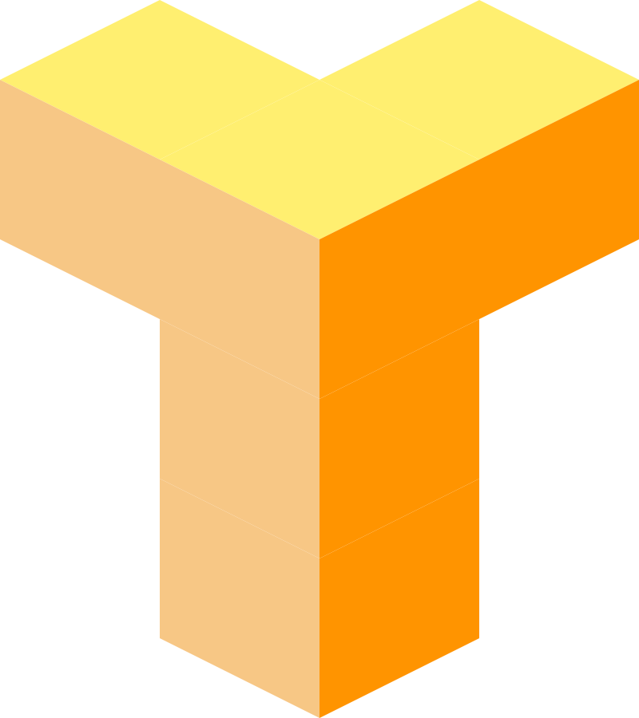

<h1> Talos3D Core</h1>

[](https://github.com/appverket/talos3D/actions/workflows/ci.yml)
[](./LICENSE)

Talos3D Core is an open-source 3D design platform built with Rust and Bevy.
Humans, AI agents and specialized editions work on the same authored model,
through the same commands and undo history.

Core provides geometry, editing, persistence and the public capability
contracts. **Talos3D Architecture** is a separate edition: its building
entities, construction knowledge, jurisdiction rules and product composition
live outside this repository. Community and private editions can use the same
platform contracts for other disciplines.

## Status

This is an actively evolving project, built and run from source. APIs and file
formats can change; preserve project backups when upgrading. Capabilities are
Rust plugins composed at build time; dynamic binary plugin loading is not
provided. Appverket LLC maintains the project as time permits. See
[Governance](./GOVERNANCE.md) and [Support](./SUPPORT.md) for expectations.

## Run Core

Install a current stable [Rust toolchain](https://rustup.rs/) and Git. A native
window system and GPU supported by Bevy are required for the desktop app.
On Debian/Ubuntu, install the native development libraries first:

```sh
sudo apt-get update
sudo apt-get install -y build-essential pkg-config libasound2-dev libudev-dev libwayland-dev libxkbcommon-dev
```

```sh
git clone https://github.com/appverket/talos3D.git talos3d-core
cd talos3d-core
cargo run --locked -p talos3d-core-app
```

The app includes modeling and the optional open-source terrain capability.
It builds from this checkout alone, without private repositories, accounts or
hosted services. To run without terrain:

```sh
cargo run --locked -p talos3d-core-app --no-default-features --features native
```

On macOS, Cargo builds require the Xcode Command Line Tools. On Windows, use
the Rust MSVC toolchain with the Visual Studio C++ build tools. First builds
compile Bevy and can take several minutes.

## Connect an AI agent

Enable the Model Context Protocol (MCP) server:

```sh
cargo run --locked -p talos3d-core-app --features model-api -- --instance-id core --model-api-port 24842
```

The app exposes streamable HTTP at `http://127.0.0.1:24842/mcp`. Use the app's
pairing flow to obtain instance-bound credentials. Each running instance writes
a discovery manifest; use a distinct instance id and port for each process.
Start with `get_instance_info`, `get_authoring_guidance` and
`get_capability_snapshot` to discover the loaded capabilities before editing.

Read [MCP Model API](./docs/MCP_MODEL_API.md) for pairing, discovery, profiles
and examples. Guidance and knowledge are contributed by loaded capabilities;
Core alone does not supply Architecture's construction expertise.

## What Core provides

- Authored primitives, profiles, reusable Definitions and occurrences, evaluated
  bodies, editable geometry features and semantic assemblies/relations.
- Shared selection, transforms, drafting, materials, lighting and viewport UI.
- Commands, captured edit plans and history shared by interactive and API edits.
- Local project persistence, recovery and reusable content libraries.
- Capability registries for entities, tools, commands, vocabulary, validators,
  recipes, catalogs, priors, guidance and provenance.
- MCP inspection and editing, plus an assistant that uses the same model API.
- A public terrain capability and CAD drawing import infrastructure.

Availability depends on the app's loaded capabilities and feature flags.
Discover executable paths at runtime; a registered descriptor or draft does
not by itself mean geometry can be generated.

## Repository map

| Path | Responsibility |
| --- | --- |
| `app-core/` | Public desktop app composing Core and optional terrain |
| `crates/talos3d-core/` | Authored model, editor runtime, commands, registries and MCP |
| `crates/talos3d-capability-api/` | Public Rust extension facade |
| `crates/talos3d-terrain/` | Open-source terrain capability |
| `crates/cadio-ir/`, `crates/cadio-dwg/` | Drawing interchange and DWG decoding |
| `crates/cadio-tools/` | Drawing test/oracle utilities |
| `assets/` | Bundled public appearance and content assets |
| `build-support/` | Shared application build identity |
| `docs/` | User and developer documentation |
| `scripts/` | Repository and MCP verification tools |

The root Cargo workspace includes every public crate and the public app. One
lockfile pins the workspace. Specialized app compositions and their domain
integration tests belong in their own repositories.

## Develop and contribute

```sh
cargo fmt --all -- --check
cargo check --locked --workspace
cargo clippy --locked --workspace --all-targets -- -W clippy::all
cargo test --locked --workspace
cargo test --locked --workspace --features talos3d-core/model-api,talos3d-terrain/model-api
python3 scripts/check_repository.py
```

Start with [Developer Onboarding](./docs/DEVELOPER_ONBOARDING.md),
[Contributing](./CONTRIBUTING.md) and [Platform Boundaries](./docs/PLATFORM_BOUNDARIES.md).
For extension work, read [Capability Plugin API](./docs/CAPABILITY_PLUGIN_API.md)
and [Extension Architecture](./docs/EXTENSION_ARCHITECTURE.md).

[Documentation home](./docs/index.md) · [User manual](./docs/USER_MANUAL.md) ·
[Architecture](./docs/PLATFORM_ARCHITECTURE.md) · [Agent notes](./AGENTS.md)

To preview the documentation site:

```sh
python3 -m pip install -r docs/requirements.txt
mkdocs serve
```

## License and security

Core is licensed under [Apache 2.0](./LICENSE). See [NOTICE](./NOTICE) for
attribution, [asset provenance](./assets/README.md) and [Trademarks](./TRADEMARKS.md) for name and logo usage.
Report vulnerabilities using [Security](./SECURITY.md).
